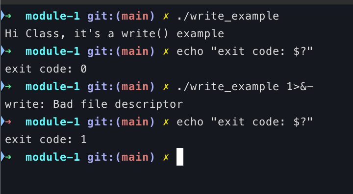

# Module 1 Discussion: System Calls

## Main idea

A system call is how a program asks the OS kernel to perform an operation that needs privileged access. The OS provides abstractions for programs and manages computer resources. User programs cannot directly access hardware or kernel memory, so their requests go through the kernel. The kernel checks each request and its permissions, which helps isolate programs, protects system stability, and gives them a consistent way to access files and devices.

### How a system call works

The mechanics depend on the machine, but on modern x86-64 Linux, programs run in an unprivileged state called User Mode (Ring 3). When a C program calls a library procedure like `read()`, the wrapper puts the system-call number into the `rax` register and passes arguments using registers like `rdi`, `rsi`, and `rdx`.

It then executes a `syscall` instruction (or a legacy software interrupt like `int 0x80`). This switches CPU execution from User Mode (Ring 3) to Kernel Mode (Ring 0). The kernel examines the parameters, uses the system-call number in `rax` to look up the correct handler in the System Call Table, and carries out the request.

Once finished, the kernel places the return value (or negative error code) in the register, restores the user process registers, and switches execution back to User Mode. The library wrapper checks for errors: if negative, it sets `errno` and returns `-1`. For `read(fd, buffer, nbytes)`, a successful return value is the number of bytes read, which is usually `nbytes`, but can be smaller at the end of a file.

### Example: `write()`

I chose `write()` for my C example. It is a POSIX file-management call that writes data from a buffer into a file.

```c
#include <errno.h>
#include <stdio.h>
#include <unistd.h>

int main(void) {
    const char message[] = "Hi Class, it's a write() example\n";
    const size_t length = sizeof(message) - 1;
    size_t written = 0;

    while (written < length) {
        ssize_t result = write(STDOUT_FILENO,
                               message + written,
                               length - written);
        if (result == -1) {
            if (errno == EINTR) {
                continue;
            }
            perror("write");
            return 1;
        }
        written += (size_t)result;
    }
    return 0;
}

```

### Result

Run the executable file. It prints the message and exits with status `0`.
Closing standard output with `1>&-` makes `write()` fail; the error is printed to standard error and the program exits with status `1`.



### Conclusion

I find it interesting that a system call can leave a process waiting. If a process is reading from the keyboard and no input has been typed, it blocks while the OS checks whether another process can run. Once input is available, the waiting process resumes.

I also noticed the difference between direct system calls and higher-level library functions like `printf()`. While `printf()` buffers output in user space within `glibc` to reduce costly mode switches, `write()` directly triggers a transition to Kernel Mode right away.

I understand the request-and-return process best through the `write()` example. Each call returns a byte count, and my loop uses it to update `written` before continuing. That makes the idea less abstract to me: my program requests a service, then uses the result the OS returns.